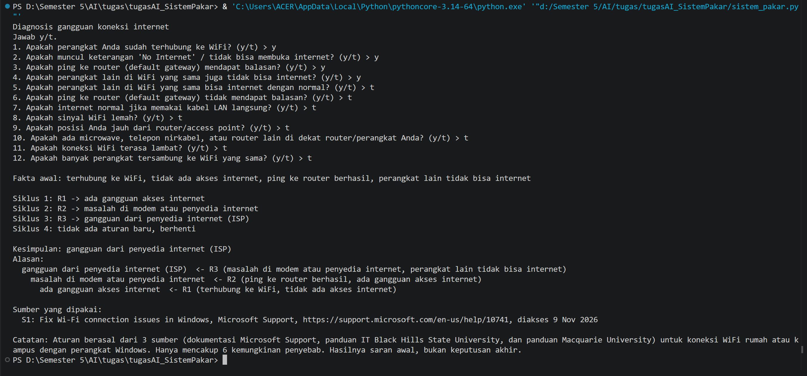
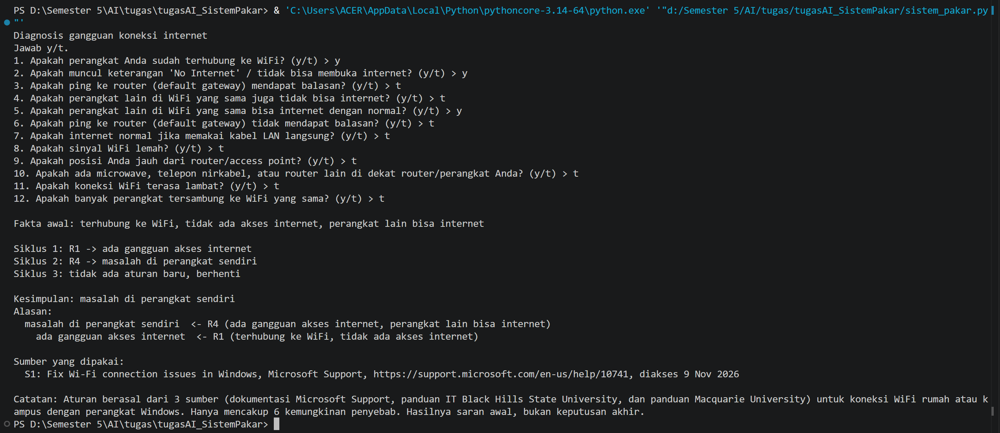
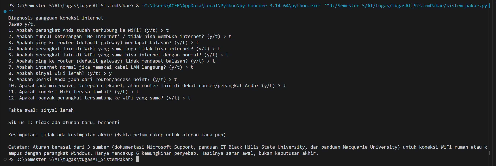

# Tugas 5 Kecerdasan Buatan — Sistem Pakar Diagnosis Gangguan Koneksi Internet

## 1. Identitas

- Nama: Ahmad Yadan Ulya Munaji
- NIM: F1D02410100

## 2. Topik dan Cara Menjalankan

Topik: diagnosis gangguan koneksi internet (WiFi) pada perangkat Windows.

- Bahasa: Python 3 (versi [ISI VERSI PYTHON ANDA], tanpa library tambahan)
- File:
  - `kb_internet.json` : file aturan (IF-THEN) beserta sumbernya
  - `sistem_pakar.py` : program (mesin forward chaining ditulis sendiri)
- Perintah menjalankan:

```
python sistem_pakar.py
```

Jawab setiap pertanyaan dengan `y` (ya) atau `t` (tidak).

## 3. Sumber dan Aturan

Sumber:

| Kode | Judul | Penerbit | URL | Diakses |
|------|-------|----------|-----|---------|
| S1 | Fix Wi-Fi connection issues in Windows | Microsoft Support | https://support.microsoft.com/en-us/help/10741 | 9 Nov 2026 |
| S2 | Wireless Signal Issues | Black Hills State University IT Help | https://support.bhsu.edu/TDClient/30/Portal/KB/ArticleDet?ID=20 | 9 Nov 2026 |
| S3 | Windows Wi-Fi troubleshooting guide | Macquarie University Student Service Desk | https://students.mq.edu.au/_archived/support/technology/service-desk/student-faq/Windows-Wi-Fi-troubleshooting-guide.pdf | 9 Nov 2026 |

Tabel aturan (8 aturan, 6 kesimpulan akhir):

| Aturan | IF | THEN | Sumber |
|--------|----|------|--------|
| R1 | terhubung ke WiFi **AND** tidak ada akses internet | ada gangguan akses internet | S1 |
| R2 | ping ke router berhasil **AND** ada gangguan akses internet | masalah di modem atau penyedia internet | S1 |
| R3 | masalah di modem atau penyedia internet **AND** perangkat lain tidak bisa internet | gangguan dari penyedia internet (ISP) | S1 |
| R4 | ada gangguan akses internet **AND** perangkat lain bisa internet | masalah di perangkat sendiri | S1 |
| R5 | ping ke router gagal **AND** internet normal lewat kabel LAN | masalah di router WiFi | S1 |
| R6 | sinyal lemah **AND** jauh dari router | sinyal lemah karena jarak | S2 |
| R7 | sinyal lemah **AND** ada perangkat penyebab interferensi dekat router | sinyal lemah karena interferensi | S2 |
| R8 | wifi lambat **AND** banyak perangkat tersambung | jaringan terlalu padat | S3 |

Rantai aturan: R1 menghasilkan "ada gangguan akses internet", dipakai R2 dan R4. R2 menghasilkan "masalah di modem atau penyedia internet", dipakai R3.

## 4. Metode: Forward Chaining

Alasan memilih forward chaining: pengguna biasanya hanya tahu gejala (fakta), bukan penyebabnya. Forward chaining berjalan dari gejala menuju penyebab, jadi cocok untuk diagnosis gangguan.

Langkah kerja program:

1. Program membaca `kb_internet.json`, lalu menanyakan fakta yang tidak pernah menjadi hasil aturan mana pun.
2. Fakta yang dijawab "ya" masuk ke memori.
3. Program mencari aturan yang syaratnya terpenuhi oleh memori dan hasilnya belum ada di memori.
4. Aturan pertama yang cocok dijalankan, hasilnya ditambahkan ke memori, dan aturan itu dicatat sebagai asal hasil tersebut.
5. Langkah 3 sampai 4 diulang sampai tidak ada aturan baru.
6. Kesimpulan akhir adalah hasil aturan yang tidak dipakai sebagai syarat aturan lain. Alasannya ditampilkan dengan menelusuri aturan yang tercatat di langkah 4.

## 5. Kasus Uji

Urutan jawaban mengikuti urutan 12 pertanyaan di program.

| # | Jawaban "ya" | Kesimpulan |
|---|--------------|------------|
| 1 | terhubung ke WiFi, tidak ada akses internet, ping ke router berhasil, perangkat lain tidak bisa internet | gangguan dari penyedia internet (ISP) |
| 2 | terhubung ke WiFi, tidak ada akses internet, perangkat lain bisa internet | masalah di perangkat sendiri |
| 3 | sinyal lemah saja | **tidak ada** (kasus negatif) |
| 4 | sinyal lemah, jauh dari router, ada perangkat penyebab interferensi, wifi lambat, banyak perangkat tersambung | sinyal lemah karena jarak; sinyal lemah karena interferensi; jaringan terlalu padat |

Kasus 1 (menghasilkan kesimpulan):



Kasus 2 (menghasilkan kesimpulan):



Kasus 3 (tidak menghasilkan kesimpulan):



Kasus 4 (beberapa kesimpulan sekaligus):


## 6. Batas Keberlakuan

Pengetahuan dalam sistem ini berasal dari tiga sumber: dokumentasi Microsoft Support, panduan IT Black Hills State University, dan panduan Macquarie University. Aturannya dibuat untuk koneksi WiFi rumah atau kampus pada perangkat Windows, dan hanya mencakup enam kemungkinan penyebab. Penyebab lain (misalnya kerusakan kabel, pengaturan DNS, atau gangguan perangkat selain Windows) tidak tercakup. Hasilnya adalah saran awal, bukan keputusan akhir, dan jika masalah berlanjut sebaiknya menghubungi penyedia internet atau teknisi jaringan. Catatan ini juga ditampilkan di akhir keluaran program.

## 7. Penggunaan Alat Bantu AI

Claude (Anthropic) dipakai sebagai alat bantu untuk menyusun draf aturan, kode program, dan README. Isi aturan sudah saya cocokkan dengan sumber, dan saya memahami serta dapat menjelaskan kode dan aturan ini. [EDIT bagian ini sesuai penggunaan Anda yang sebenarnya]
